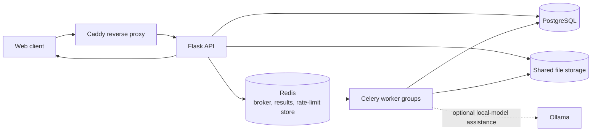
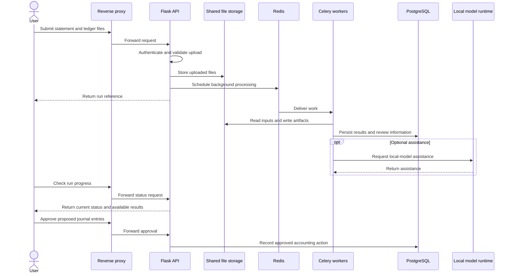

# FinSync Backend (Architecture & Documentation Showcase)

> ⚠️ **Note:** The source code for this project is currently kept **private**. This repository serves as a portfolio showcase to explain the architecture, system design, and API structure of the FinSync backend.

**🌟 Live Demo:** [https://bank-rec-frontend.vercel.app](https://bank-rec-frontend.vercel.app)

---

The FinSync backend is a robust Flask API designed for bank reconciliation, bill processing, ledger reporting, TDS, and GSTR-1 workflows. Long-running reconciliation, OCR, and report work is executed by Celery with Redis, while PostgreSQL is used for reliable application data storage.

> **Source code is private. Code walkthrough available on request.**  
> Contact: `vishalladoiya.work@gmail.com`

**Live demo:** [https://bank-rec-frontend.vercel.app]

## The problem

Comparing bank activity with accounting records often means moving between spreadsheets, tracing discrepancies manually, and rechecking the same work. That takes time away from close and reporting work, and makes it harder to review how a result was reached.

I built FinSync for finance teams, accountants, and small businesses that need a repeatable way to process statements, review reconciliation results, and prepare follow-up accounting work.

## Features

- Upload bank statements and ledger files in common spreadsheet formats.
- Process PDF ledgers through document extraction and OCR.
- Run reconciliation as background work and check progress separately.
- Review matched, unresolved, and audit-focused results.
- Use optional local-LLM assistance during matching.
- Generate reports and download them for review.
- Review and approve proposed journal entries.
- Process bills and run bill-to-bank workflows.
- Browse previous reconciliation runs.

## Architecture

### System overview

### Reconciliation run

### Component responsibilities

- **Caddy** provides the public reverse-proxy edge in the target deployment.
- **Flask API** handles authentication, upload validation, requests, and status/result access.
- **Redis** supports queued work, task results, and rate-limit storage.
- **Celery workers** process ingestion, reconciliation, accounting workflows, and reports outside the request cycle.
- **PostgreSQL** stores application and accounting workflow data.
- **Shared file storage** holds uploaded documents and generated artifacts used by the API and workers.
- **Ollama** provides optional local-model assistance.

### Why asynchronous processing

Document extraction, reconciliation, and report generation can take longer than a typical web request. Queueing this work lets the API respond promptly while workers process jobs independently. Separate worker groups help isolate different workloads; clients can poll for progress, and workers can retry eligible failures without keeping a browser request open.

## Design decisions and trade-offs

| Decision | Why I chose it | Trade-off |
| --- | --- | --- |
| Queue work outside the API request | Keeps long-running document and report work from blocking request handling | Adds worker operations and status polling |
| Separate worker groups by workload | Lets different processing stages run and scale independently | Requires coordination across stages |
| Keep uploaded files in shared storage | Workers can process documents without sending file contents through the task broker | All participating workers need access to the same storage |
| Use a local model runtime for optional assistance | Keeps that processing within the deployment and avoids a required external model API | Requires local compute and operational maintenance |
| Use status polling for background work | Gives clients a simple way to follow progress without a persistent connection | Clients must poll and handle work that is still in progress |
| Add tiered IP and user limits plus an active-run cap | Helps control repeated requests and concurrent reconciliation work | Limits require shared Redis state and may reject work at capacity |
| Keep the API focused on orchestration and access | Allows background workers to own time-consuming processing | More components make end-to-end debugging more involved |

## Security and reliability

- JWT authentication protects account and user-scoped operations.
- User-specific reconciliation history and results are checked against the authenticated identity.
- Uploads are validated before processing.
- Production startup checks that application secrets are present and sufficiently strong.
- Proxy-aware request handling supports client-IP-based controls behind a trusted proxy.
- Tiered per-IP and per-user rate limits use Redis-backed storage. Ordinary routes fail open when that storage is unavailable; authentication routes fail closed.
- A per-user cap limits concurrent active reconciliation submissions. Quota release on terminal run states is still planned.
- Reconciliation results include review and audit information.
- The API and worker container images run as non-root users.

## Technology stack

| Layer | Technology | Why it fits |
| --- | --- | --- |
| API | Python, Flask | Clear request and service boundaries |
| Authentication | JWT | Carries authenticated identity across API requests |
| Background processing | Celery, Redis | Queues long-running work outside web requests |
| Application data | PostgreSQL | Persistent storage for account and workflow data |
| Document ingestion | Spreadsheet readers, PDF extraction, OCR | Handles supported spreadsheet and scanned-document inputs |
| Optional AI assistance | Ollama | Runs model-assisted work within the deployment |
| Deployment | Docker Compose, Caddy | Runs the application components and provides a reverse-proxy edge |

## API capabilities

| Area | Capability |
| --- | --- |
| Authentication | Create an account, sign in, verify email, and manage an authenticated session |
| Uploads and reconciliation | Submit bank, ledger, and bill documents for processing |
| Status and results | Follow background work and review completed reconciliation results |
| Reports | Generate and retrieve downloadable reports |
| Journal approvals | Review and approve proposed journal entries |
| History | Browse and manage previous reconciliation runs |

## Deployment

The application is organized for Docker Compose deployment, with the API and worker groups running as separate services. Caddy sits at the deployment edge as the reverse proxy, while Redis, PostgreSQL, and shared file storage support the application internally. Worker groups can be scaled according to workload. Production deployments should provide persistent storage and protect the data services within the deployment network.

## What I learned

- Designing API boundaries around authenticated user workflows.
- Coordinating multi-stage background jobs and status reporting.
- Handling multiple document formats in a processing pipeline.
- Integrating optional local-model assistance into an existing workflow.
- Keeping shared state and files available across API and worker processes.
- Building review steps for accounting actions rather than applying proposals silently.

## Roadmap

- Release active-run quota when a run completes, fails, or is deleted.
- Add end-to-end monitoring for queue wait time and worker health.
- Expand integration and load testing for concurrent document processing.
- Evaluate object storage for deployments that span multiple hosts.
- Add account recovery workflows.
- Improve reviewer feedback and reporting workflows.

## Contact

- Email: `vishalladoiya.work@gmail.com`
- LinkedIn: `https://www.linkedin.com/in/vishal-ladoiya-13bb45307/`

I’m happy to walk through the architecture and code live.

## License

All rights reserved. This repository contains documentation only.
